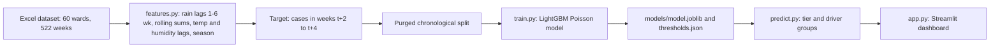

# Architecture

## 1. Goal
Predict dengue risk (Low / Medium / High / Critical) for each ward, 2 to 4 weeks ahead, using weather and ward conditions. Rain takes about 2 to 4 weeks to turn into hospital cases, so the model uses rainfall lags.

## 2. Data flow

- Raw data is loaded once and sorted by ward and date.
- All lag features are computed per ward, so one ward's weather never leaks into another.
- Training is offline (`train.py`). The dashboard only loads the saved model.

## 3. Chronological validation split
| Set | Period | Use |
|---|---|---|
| Train | 2016 to 2022 | fit the model |
| Validation | 2023 | early stopping and risk-tier cut-offs |
| Test | 2024 to 2025 | final check, run once |

The target for week t looks 4 weeks ahead (cases in t+2 to t+4). So the last 4 weeks of train and validation are **purged**: a row is kept only if its whole target window ends inside its own period. This stops future cases leaking into earlier sets. Features use only data from week t or earlier. Random splitting is not used, because it would let the model see the future.

## 4. Model choice
- **LightGBM with Poisson objective.** Case counts are non-negative, with many zeros, so Poisson fits better than plain regression.
- It is fast, small, and handles mixed features without scaling.
- Compared with deep learning: the dataset has about 31,000 rows, so a deep model adds cost with little benefit.
- **Drivers:** LightGBM per-prediction contributions, grouped into Recent rainfall, Temperature, Humidity, Season, Ward vulnerability. They show which factors the model used. They are **not proof of cause**.

## 5. Risk tiers
- True tiers use training-target percentiles (70, 90, 97): Low, Medium, High, Critical.
- Predicted-case cut-offs (6.62, 21.17, 34.49) were tuned on **validation only**, never on test data.

## 6. Cost and speed controls
- **No external API and no LLM at run time**, so there is no API or token cost.
- The model is serialized with `joblib`. One prediction takes about 33 ms.
- The dashboard loads the model and data once with `st.cache_resource`. Predictions and rankings are cached with `st.cache_data`, so the same ward and date is never recomputed.
- The ranking of all 60 wards uses one batch model call, not 60 calls.
- Training happens offline. The app never retrains.
- AI assistant (Claude) was used only during development, with short focused prompts. It is not part of the running system.

## 7. Test results and limitations
- Test (2024 to 2025): MAE 2.31 (always-guess-the-average: 8.92), RMSE 4.40, exact tier correct 83%, within one tier 98.9%.
- **Limitation:** Critical precision is 13.7%, so there are many false alarms. The cut-offs were tuned on 2023, a high-dengue year, while 2024 to 2025 had fewer cases. We did not retune on test data.
- **Next steps (Phase 2):** rolling multi-year validation for the cut-offs, forecast confidence intervals, and a ward heatmap.
